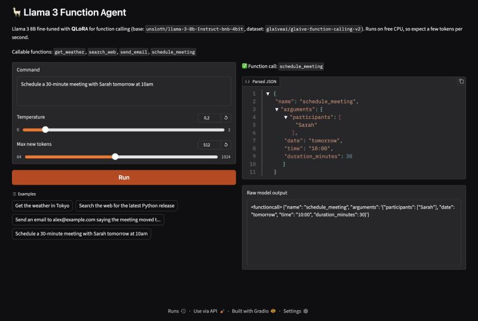
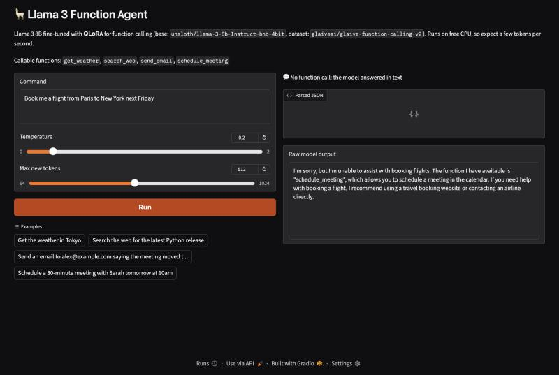

# 🦙 Llama 3 Function Agent

A production-ready full-stack AI application for deploying a fine-tuned Llama 3 model on DigitalOcean. Built with FastAPI, Streamlit, and Ollama.


## 📋 Table of Contents

- [Overview](#-overview)
- [Results](#-results)
- [Architecture](#-architecture)
- [Prerequisites](#-prerequisites)
- [DigitalOcean Deployment](#-digitalocean-deployment)
- [Local Development](#-local-development)
- [API Reference](#-api-reference)
- [Configuration](#-configuration)
- [Troubleshooting](#-troubleshooting)

## 🎯 Overview

This application provides a clean interface for interacting with Llama 3 for function calling capabilities. Users can input natural language commands and receive structured JSON responses.

### Features

- **FastAPI Backend**: High-performance async API with automatic OpenAPI documentation
- **Streamlit Frontend**: Clean two-column UI with real-time status indicators
- **Ollama Integration**: Seamless connection to locally running Llama 3 models
- **JSON Parsing**: Automatic extraction and formatting of JSON from model responses
- **Input Sanitization**: Protection against prompt injection attacks
- **Docker Compose**: One-command deployment with health checks

## 📊 Results

Llama 3 8B Instruct fine-tuned with QLoRA (Unsloth, 60 steps on a free Colab T4) on
[glaive-function-calling-v2](https://huggingface.co/datasets/glaiveai/glaive-function-calling-v2).
Evaluated on 100 held-out Glaive samples (60 that need a call, 40 out-of-scope requests),
run locally on CPU through the app's own prompt builder and parser:

| | Fine-tuned | Base | Base + format instructions |
|---|---:|---:|---:|
| Fully correct (right call + arguments, or correct decline) | **98%** | 40% | 96% |
| Function called when expected | **98.3%** | 0% | 95.0% |
| All expected arguments correct | **96.7%** | 0% | 93.3% |
| Correct decline on out-of-scope requests | 100% | 100% | 100% |
| Median prompt length (tokens) | **166** | 166 | 228 |

Without fine-tuning, the base model never calls a function; it narrates a call and makes up
the result. Spelling out the format in the prompt recovers most of that, so the fine-tune's
lead over a well-prompted base model is small and not statistically significant on this set
(p = 0.69). Its advantage is that it needs no instructions, which means 27% shorter prompts.
Methodology, caveats and how to reproduce: [eval/README.md](eval/README.md).

| Request → function call | Out-of-scope request → declines in text |
|---|---|
|  |  |

**Models on the Hugging Face Hub:**
[GGUF for Ollama / llama.cpp](https://huggingface.co/AOUNZakaria/llama3-8b-function-calling-gguf) ·
[LoRA adapters](https://huggingface.co/AOUNZakaria/llama3-8b-function-calling-lora)

## 🏗 Architecture

```
┌─────────────────┐     ┌─────────────────┐     ┌─────────────────┐
│                 │     │                 │     │                 │
│   Streamlit     │────▶│    FastAPI      │────▶│    Ollama       │
│   Frontend      │     │    Backend      │     │    (Llama 3)    │
│   Port: 8501    │     │    Port: 8000   │     │    Port: 11434  │
│                 │     │                 │     │                 │
└─────────────────┘     └─────────────────┘     └─────────────────┘
```

## 📦 Prerequisites

- **Docker** & **Docker Compose** (v2.0+)
- **Ollama** installed on host or running as container
- **Llama 3** model pulled in Ollama
- **4GB+ RAM** (8GB+ recommended for larger models)

## 🌊 DigitalOcean Deployment

### Step 1: Create a Droplet

1. Log in to [DigitalOcean](https://cloud.digitalocean.com/)
2. Create a new Droplet:
   - **Image**: Ubuntu 22.04 LTS
   - **Size**: CPU-Optimized (c-4 or higher recommended)
   - **Region**: Choose closest to your users
   - **Authentication**: SSH key (recommended)

> 💡 For GPU inference, consider DigitalOcean's GPU Droplets or use a CPU-optimized instance with quantized models.

### Step 2: Install Docker

SSH into your Droplet and run:

```bash
# Update system packages
sudo apt update && sudo apt upgrade -y

# Install Docker
curl -fsSL https://get.docker.com | sudo sh

# Add user to docker group
sudo usermod -aG docker $USER

# Install Docker Compose plugin
sudo apt install docker-compose-plugin -y

# Verify installation
docker --version
docker compose version

# Log out and back in for group changes
exit
```

### Step 3: Install Ollama

```bash
# SSH back into the Droplet
ssh root@your-droplet-ip

# Install Ollama
curl -fsSL https://ollama.com/install.sh | sh

# Verify Ollama is running
ollama --version

# Check Ollama service status
sudo systemctl status ollama
```

### Step 4: Register the Fine-Tuned Model

The fine-tuned weights are published on the Hugging Face Hub:

- GGUF (for Ollama / llama.cpp): [AOUNZakaria/llama3-8b-function-calling-gguf](https://huggingface.co/AOUNZakaria/llama3-8b-function-calling-gguf)
- LoRA adapters (for transformers / PEFT): [AOUNZakaria/llama3-8b-function-calling-lora](https://huggingface.co/AOUNZakaria/llama3-8b-function-calling-lora)

```bash
# Download the GGUF (~4.9 GB) and the Modelfile that ships with it
pip install -U huggingface_hub
huggingface-cli download AOUNZakaria/llama3-8b-function-calling-gguf \
  llama-3-8b-Instruct.Q4_K_M.gguf Modelfile --local-dir ./model
cd model

# Register it under the name the backend expects (OLLAMA_MODEL)
ollama create llama3-function-calling -f Modelfile

# Verify model is available
ollama list
```

> The backend sends prompts with `raw: true`, already in the Llama 3 chat format, so the
> Modelfile's `TEMPLATE`/`SYSTEM` are not applied on `/chat` requests.

### Step 5: Deploy the Application

```bash
# Clone the repository
git clone https://github.com/yourusername/llama3-function-agent.git
cd llama3-function-agent

# Build and start services
docker compose up -d

# View logs
docker compose logs -f

# Check status
docker compose ps
```

### Step 6: Configure Firewall

```bash
# Allow HTTP traffic
sudo ufw allow 8501/tcp  # Streamlit
sudo ufw allow 8000/tcp  # FastAPI (optional, for API access)
sudo ufw enable
```

### Step 7: Access the Application

- **Frontend**: `http://your-droplet-ip:8501`
- **API Docs**: `http://your-droplet-ip:8000/docs`

## 💻 Local Development

### Quick Start

```bash
# Clone the repository
git clone https://github.com/yourusername/llama3-function-agent.git
cd llama3-function-agent

# Ensure Ollama is running with the fine-tuned model (see Step 4)
ollama serve  # If not running as service
ollama list   # should show llama3-function-calling

# Start the application
docker compose up --build
```

### Development Mode (Without Docker)

```bash
# Backend
cd app/backend
python -m venv venv
source venv/bin/activate  # On Windows: venv\Scripts\activate
pip install -r requirements.txt
uvicorn main:app --reload --host 0.0.0.0 --port 8000

# Frontend (new terminal)
cd app/frontend
python -m venv venv
source venv/bin/activate
pip install -r requirements.txt
streamlit run ui.py
```

## 📚 API Reference

### Health Check

```http
GET /health
```

**Response:**
```json
{
  "status": "healthy",
  "ollama_connected": true,
  "model_available": true
}
```

### Chat Endpoint

```http
POST /chat
Content-Type: application/json

{
  "message": "Get weather in Tokyo",
  "temperature": 0.2,
  "max_tokens": 512,
  "functions": null
}
```

`functions` is optional: a list of JSON-schema function definitions (Glaive format) to offer
the model. When omitted, the defaults from `GET /functions` are used
(`get_weather`, `search_web`, `send_email`, `schedule_meeting`).

**Response:**
```json
{
  "success": true,
  "response": "<functioncall> {\"name\": \"get_weather\", \"arguments\": '{\"location\": \"Tokyo\"}'}",
  "parsed_output": {
    "raw_text": "...",
    "parsed_json": {
      "name": "get_weather",
      "arguments": "{\"location\": \"Tokyo\"}"
    },
    "parse_error": null,
    "function_call": {
      "name": "get_weather",
      "arguments": { "location": "Tokyo" }
    }
  },
  "model": "llama3-function-calling",
  "tokens_used": 21
}
```

## ⚙️ Configuration

### Environment Variables

| Variable | Default | Description |
|----------|---------|-------------|
| `OLLAMA_BASE_URL` | `http://host.docker.internal:11434` | Ollama API endpoint |
| `OLLAMA_MODEL` | `llama3-function-calling` | Model name in Ollama |
| `REQUEST_TIMEOUT` | `120.0` | Request timeout in seconds |
| `NUM_CTX` | `4096` | Context window passed to Ollama |

### Modifying the Backend

Set the variables above on the `backend` service in `docker-compose.yml`, or edit the
defaults (and `DEFAULT_FUNCTIONS`) in `app/backend/main.py`.

### Using a Custom Model

1. Create your model in Ollama:
   ```bash
   ollama create my-custom-llama3 -f Modelfile
   ```

2. Point the backend at it (`docker-compose.yml`):
   ```yaml
   environment:
     - OLLAMA_MODEL=my-custom-llama3
   ```

3. Rebuild the containers:
   ```bash
   docker compose up --build -d
   ```

## 🔧 Troubleshooting

### Ollama Connection Issues

**Symptom**: "Cannot connect to Ollama" error

**Solutions**:

1. Verify Ollama is running:
   ```bash
   curl http://localhost:11434/api/tags
   ```

2. On Linux, ensure `host.docker.internal` is configured:
   ```yaml
   # docker-compose.yml
   extra_hosts:
     - "host.docker.internal:host-gateway"
   ```

3. Check firewall rules:
   ```bash
   sudo ufw allow 11434/tcp
   ```

### Model Not Loading

**Symptom**: "Model Not Loaded" in status panel

**Solutions**:

1. Verify model is pulled:
   ```bash
   ollama list
   ```

2. Register the model if missing (see Step 4):
   ```bash
   ollama create llama3-function-calling -f Modelfile
   ```

3. Check available memory:
   ```bash
   free -h
   ```

### Docker Build Failures

**Solutions**:

1. Clear Docker cache:
   ```bash
   docker compose build --no-cache
   ```

2. Prune unused resources:
   ```bash
   docker system prune -a
   ```

### Slow Response Times

**Solutions**:

1. Use a quantized model (e.g., `llama3:8b-q4_0`)
2. Increase Droplet resources
3. Adjust `max_tokens` in requests

## 📁 Project Structure

```
llama3-function-agent/
├── app/
│   ├── backend/
│   │   ├── main.py           # FastAPI application
│   │   ├── test_main.py      # Backend tests (pytest, Ollama mocked)
│   │   ├── requirements.txt  # Python dependencies
│   │   └── Dockerfile        # Backend container
│   └── frontend/
│       ├── ui.py             # Streamlit application
│       ├── requirements.txt  # Python dependencies
│       └── Dockerfile        # Frontend container
├── deploy/
│   ├── huggingface-gradio-space/  # Gradio + llama-cpp-python Space (free CPU tier)
│   └── huggingface-space/         # Docker Space: Ollama + FastAPI + Streamlit
├── eval/
│   ├── build_dataset.py      # Samples the held-out eval set from Glaive
│   ├── run_eval.py           # Runs a GGUF over it via the backend's prompt + parser
│   ├── score.py              # Metrics → eval/README.md
│   ├── data/                 # The 100 eval samples
│   └── results/              # Per-sample outputs for each model
├── docs/                     # Screenshots
├── notebooks/
│   └── finetune.ipynb        # Llama 3 fine-tuning notebook
├── docker-compose.yml        # Service orchestration
├── README.md                 # Documentation
└── project_context.md        # Project context
```

## 🎓 Fine-Tuning Guide

The `notebooks/finetune.ipynb` notebook provides a complete tutorial for fine-tuning Llama 3 8B for function calling:

### Features

- **QLoRA Training**: Memory-efficient 4-bit quantization with LoRA adapters
- **Unsloth Optimization**: 2x faster training, 50% less memory
- **Google Colab Compatible**: Works on free T4 GPU tier
- **GGUF Export**: Ready for Ollama deployment

### Quick Start (Colab)

1. Open `notebooks/finetune.ipynb` in Google Colab
2. Enable GPU runtime (Runtime → Change runtime type → T4 GPU)
3. Run all cells sequentially
4. Download the GGUF file for Ollama deployment

### Training Configuration

| Parameter | Value |
|-----------|-------|
| Base Model | `unsloth/llama-3-8b-Instruct-bnb-4bit` |
| Dataset | `glaiveai/glaive-function-calling-v2` |
| Learning Rate | 2e-4 |
| Batch Size | 2 (effective: 8 with gradient accumulation) |
| LoRA Rank | 16 |
| Training Steps | 60 (increase for production) |

## 📄 License

This project is licensed under the MIT License - see the [LICENSE](LICENSE) file for details.

## 🤝 Contributing

1. Fork the repository
2. Create a feature branch (`git checkout -b feature/amazing-feature`)
3. Commit changes (`git commit -m 'Add amazing feature'`)
4. Push to branch (`git push origin feature/amazing-feature`)
5. Open a Pull Request

---

<p align="center">
  Built with ❤️ using FastAPI, Streamlit, and Ollama
</p>
